# UnityBench-Mini3D

**Evaluating LLM Agents for 3D Game Development in Unity**

  
  &nbsp;
  

> **🚧 Work in Progress**
> The challenge scene gallery is presented below. Unity task projects and the evaluation framework are being prepared for release.

**77 tasks · 7 categories · 3 difficulty tiers · 1,178 milestone tests**

UnityBench-Mini3D evaluates LLM agents on project-level Unity development: modifying existing projects whose correctness depends on code, scene structure, component configuration, and runtime behavior.

[Challenge Scenes](#unitybench-mini3d-challenge-scenes) · [Task Structure](#task-structure) · [Evaluation Overview](#evaluation-overview) · [Release Roadmap](#release-roadmap)

## UnityBench-Mini3D Challenge Scenes

The gallery below presents all 77 challenges from Appendix A of the paper, in their original order. Expand a category to browse its tasks.

Each pair shows the **Initial Challenge Template** and a human-authored **Completed Golden Reference**. These are reference examples, not model outputs or evaluation results; screenshots alone do not capture all structural and runtime requirements.

| Category | Tasks | Milestone tests |
| --- | ---: | ---: |
| [User Interface](#user-interface) | 9 | 111 |
| [Animation & Animator](#animation-and-animator) | 12 | 179 |
| [Editor Operations](#editor-operations) | 11 | 142 |
| [Scene & Level Construction](#scene-and-level-construction) | 19 | 365 |
| [Particles & Shaders](#particles-and-shaders) | 12 | 155 |
| [Physics & Collision](#physics-and-collision) | 11 | 168 |
| [Miscellaneous](#miscellaneous) | 3 | 58 |
| **Total** | **77** | **1,178** |

**Difficulty:** 25 Easy · 29 Medium · 23 Hard

<strong>User Interface</strong> · 9 tasks · 111 milestone tests

### 0025 — Compass HUD Direction Calibration

**Easy · 6 milestone tests** · `0025-FPSCompassHUDCalibration`

Correct the compass HUD so its cardinal directions match the player's world-space heading.

<table>
<tr><th width="50%">Initial Challenge Template</th><th width="50%">Completed Golden Reference</th></tr>
<tr><td><a href="docs/assets/challenge-scenes/0025-initial.jpg">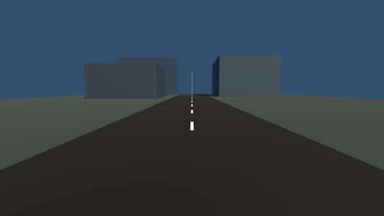</a></td><td><a href="docs/assets/challenge-scenes/0025-reference.jpg">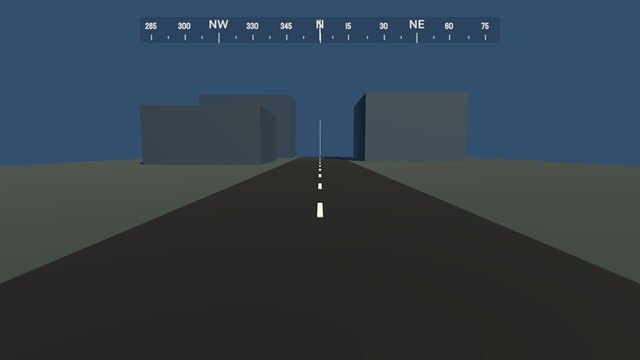</a></td></tr>
</table>

### 0050 — Snake Game Implemented with Unity UI Toolkit

**Easy · 23 milestone tests** · `0050-UIToolkitSnake`

Build a futuristic UI Toolkit Snake game with adjustable speed, scoring, and restart controls.

<table>
<tr><th width="50%">Initial Challenge Template</th><th width="50%">Completed Golden Reference</th></tr>
<tr><td></td><td><a href="docs/assets/challenge-scenes/0050-reference.jpg">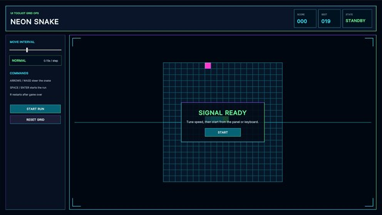</a></td></tr>
</table>

### 0063 — Minimap UI Implementation

**Easy · 7 milestone tests** · `0063-MinimapRealization`

Implement a circular, north-up minimap with a centered player arrow that follows the player's heading.

<table>
<tr><th width="50%">Initial Challenge Template</th><th width="50%">Completed Golden Reference</th></tr>
<tr><td></td><td><a href="docs/assets/challenge-scenes/0063-reference.jpg">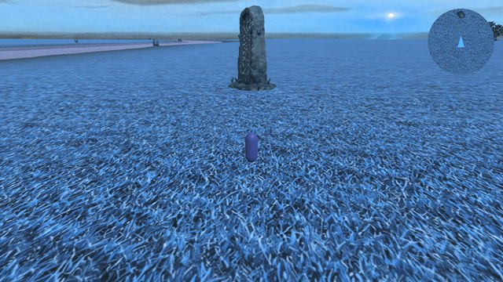</a></td></tr>
</table>

### 0010 — UI Sprite Sheet Slicing

**Medium · 11 milestone tests** · `0010-SplitTheUI`

Slice five sprite sheets using the required automatic, content-aware, and grid-based strategies.

<table>
<tr><th width="50%">Initial Challenge Template</th><th width="50%">Completed Golden Reference</th></tr>
<tr><td></td><td><a href="docs/assets/challenge-scenes/0010-reference.jpg">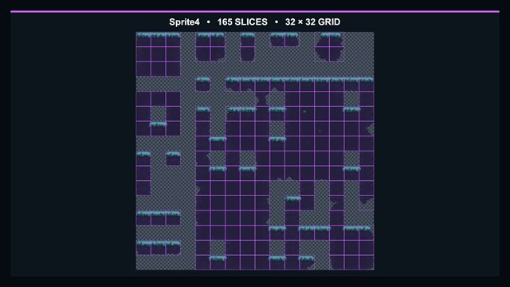</a></td></tr>
</table>

### 0023 — GoldenBench UI Recreation

**Medium · 9 milestone tests** · `0023-UIRedoBench`

Recreate the reference character-selection screen using the supplied UI assets.

<table>
<tr><th width="50%">Initial Challenge Template</th><th width="50%">Completed Golden Reference</th></tr>
<tr><td></td><td><a href="docs/assets/challenge-scenes/0023-reference.jpg">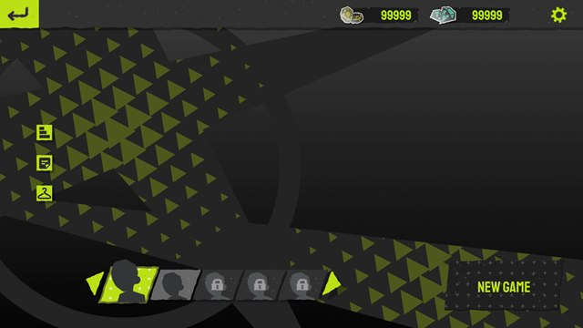</a></td></tr>
</table>

### 0049 — Recreate T-Rex Runner with UI Toolkit

**Medium · 18 milestone tests** · `0049-UIDocument`

Recreate T-Rex Runner with UI Toolkit using the supplied frontend reference and sprites.

<table>
<tr><th width="50%">Initial Challenge Template</th><th width="50%">Completed Golden Reference</th></tr>
<tr><td></td><td><a href="docs/assets/challenge-scenes/0049-reference.jpg">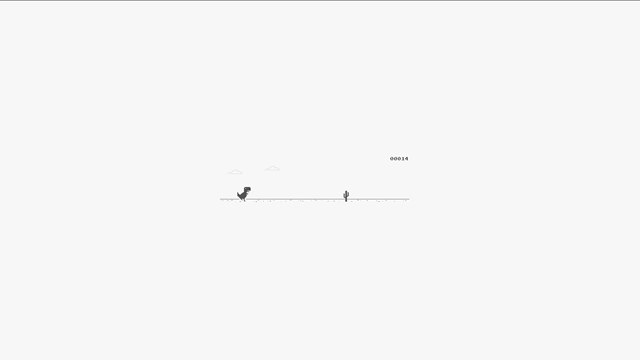</a></td></tr>
</table>

### 0015 — ShootAhead Mobile HUD Refactor

**Hard · 9 milestone tests** · `0015-ShootAheadUguiMobileHud`

Refactor the mobile combat HUD into a maintainable UGUI interface that adapts to different screen sizes.

<table>
<tr><th width="50%">Initial Challenge Template</th><th width="50%">Completed Golden Reference</th></tr>
<tr><td></td><td><a href="docs/assets/challenge-scenes/0015-reference.jpg">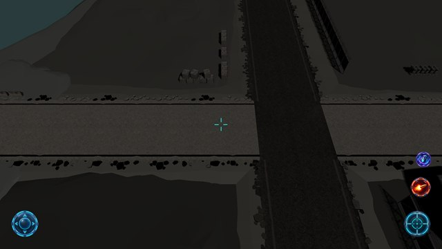</a></td></tr>
</table>

### 0062 — Build an Endless UI Toolkit Bubble Shooter

**Hard · 19 milestone tests** · `0062-UIToolkitBubbleDragon`

Build an endless UI Toolkit bubble shooter with aiming, matching, scoring, and complete game-state flows.

<table>
<tr><th width="50%">Initial Challenge Template</th><th width="50%">Completed Golden Reference</th></tr>
<tr><td></td><td><a href="docs/assets/challenge-scenes/0062-reference.jpg">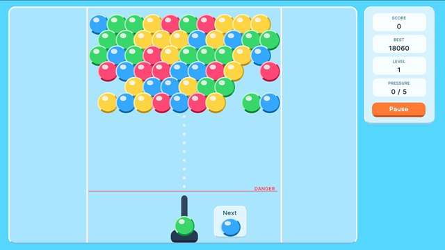</a></td></tr>
</table>

### 0078 — Build a First-Person F-22 Cockpit HUD

**Hard · 9 milestone tests** · `0078-JetHUD`

Create a cockpit HUD whose flight instruments and delayed impact point respond to live aircraft state.

<table>
<tr><th width="50%">Initial Challenge Template</th><th width="50%">Completed Golden Reference</th></tr>
<tr><td><a href="docs/assets/challenge-scenes/0078-initial.jpg">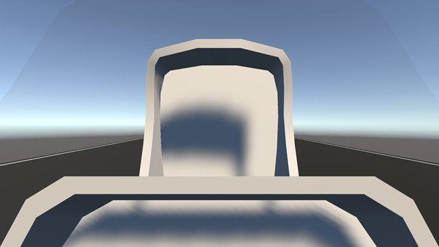</a></td><td><a href="docs/assets/challenge-scenes/0078-reference.jpg">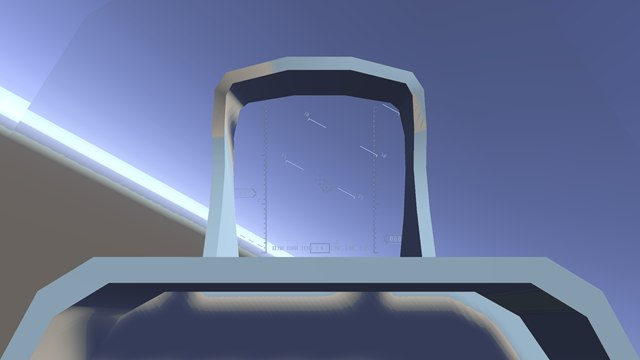</a></td></tr>
</table>

<strong>Animation &amp; Animator</strong> · 12 tasks · 179 milestone tests

### 0000 — Build an Automatic Opening and Closing Door Scene (AutoDoor)

**Easy · 29 milestone tests** · `0000-AutoDoor`

Build an automatic door that smoothly loops through opening and closing around a hinge pivot.

<table>
<tr><th width="50%">Initial Challenge Template</th><th width="50%">Completed Golden Reference</th></tr>
<tr><td></td><td><a href="docs/assets/challenge-scenes/0000-reference.jpg">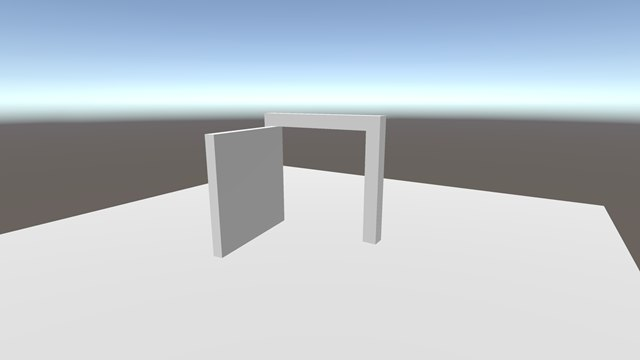</a></td></tr>
</table>

### 0006 — Tank Track Animation

**Easy · 2 milestone tests** · `0006-TankTrackAnimation`

Animate both tank tracks and their road wheels continuously with frame-rate-independent motion.

<table>
<tr><th width="50%">Initial Challenge Template</th><th width="50%">Completed Golden Reference</th></tr>
<tr><td></td><td><a href="docs/assets/challenge-scenes/0006-reference.jpg">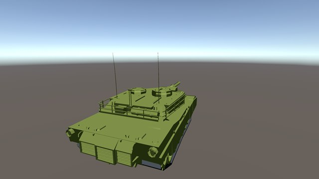</a></td></tr>
</table>

### 0008 — Swordsman Attack

**Easy · 4 milestone tests** · `0008-SwordsmanAttack`

Author a diagonal sword-slash animation with correctly timed attack-window events and target contact.

<table>
<tr><th width="50%">Initial Challenge Template</th><th width="50%">Completed Golden Reference</th></tr>
<tr><td><a href="docs/assets/challenge-scenes/0008-initial.jpg">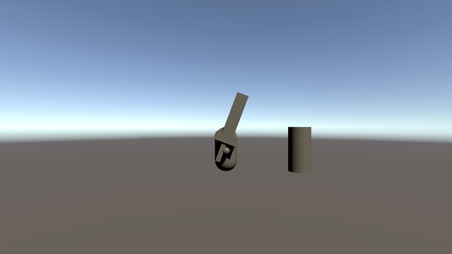</a></td><td><a href="docs/assets/challenge-scenes/0008-reference.jpg">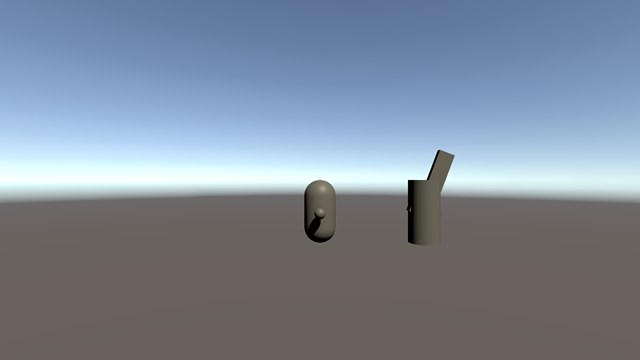</a></td></tr>
</table>

### 0009 — Animation Events

**Medium · 9 milestone tests** · `0009-AnimationEvents`

Configure animation events to trigger the required actions at the correct playback times.

<table>
<tr><th width="50%">Initial Challenge Template</th><th width="50%">Completed Golden Reference</th></tr>
<tr><td></td><td><a href="docs/assets/challenge-scenes/0009-reference.jpg">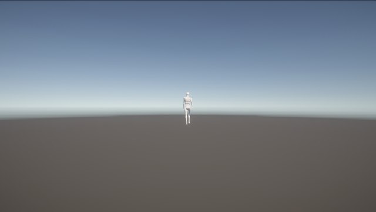</a></td></tr>
</table>

### 0029 — Layered Character Animation

**Medium · 16 milestone tests** · `0029-AnimatorLayer`

Configure a character to switch between full-body animation and simultaneous body-part animations.

<table>
<tr><th width="50%">Initial Challenge Template</th><th width="50%">Completed Golden Reference</th></tr>
<tr><td></td><td><a href="docs/assets/challenge-scenes/0029-reference.jpg">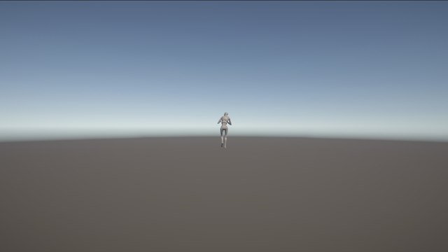</a></td></tr>
</table>

### 0035 — Humanoid IK

**Medium · 13 milestone tests** · `0035-HumanoidIK`

Implement humanoid inverse kinematics so animated bones follow the specified position and rotation targets.

<table>
<tr><th width="50%">Initial Challenge Template</th><th width="50%">Completed Golden Reference</th></tr>
<tr><td></td><td><a href="docs/assets/challenge-scenes/0035-reference.jpg">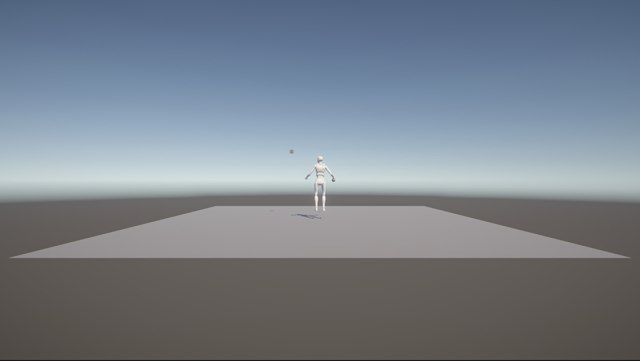</a></td></tr>
</table>

### 0041 — Excavator AnimationClip Dig and Dump Task

**Medium · 9 milestone tests** · `0041-ExcavatorAnimationClipDigDump`

Author excavator Dig and Dump clips that scoop, carry, and unload a cube using the bucket collider.

<table>
<tr><th width="50%">Initial Challenge Template</th><th width="50%">Completed Golden Reference</th></tr>
<tr><td><a href="docs/assets/challenge-scenes/0041-initial.jpg">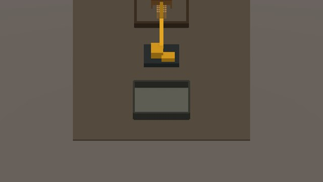</a></td><td><a href="docs/assets/challenge-scenes/0041-reference.jpg">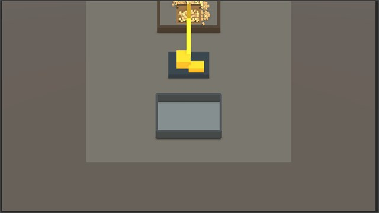</a></td></tr>
</table>

### 0046 — Animation Script Playable

**Medium · 17 milestone tests** · `0046-AnimationScriptPlayable`

Drive character animation through the Animator and C# Playables without a runtime Animator Controller.

<table>
<tr><th width="50%">Initial Challenge Template</th><th width="50%">Completed Golden Reference</th></tr>
<tr><td><a href="docs/assets/challenge-scenes/0046-initial.jpg">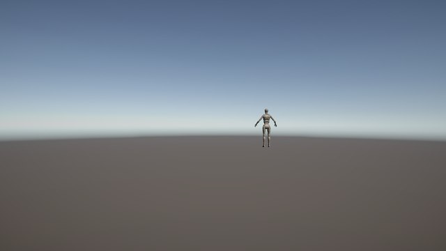</a></td><td><a href="docs/assets/challenge-scenes/0046-reference.jpg">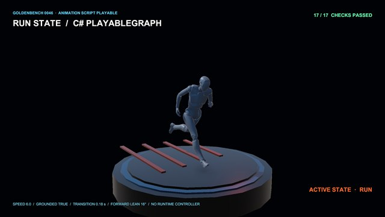</a></td></tr>
</table>

### 0055 — Archer Animator Blend Tree Controller

**Medium · 30 milestone tests** · `0055-ArcherAnimatorController`

Configure the archer's movement and Animator for running, crouching, aiming, diving, and falling.

<table>
<tr><th width="50%">Initial Challenge Template</th><th width="50%">Completed Golden Reference</th></tr>
<tr><td><a href="docs/assets/challenge-scenes/0055-initial.jpg">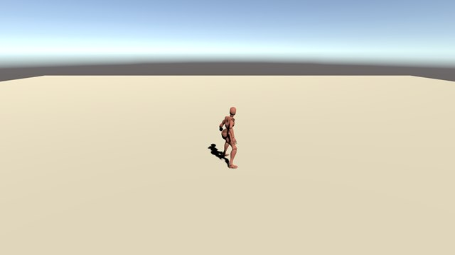</a></td><td><a href="docs/assets/challenge-scenes/0055-reference.jpg">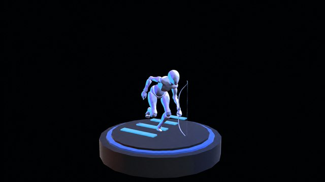</a></td></tr>
</table>

### 0065 — ShootAhead Split Body Aim

**Medium · 12 milestone tests** · `0065-ShootAheadSplitBodyAim`

Complete split-body aiming so the character's movement and upper-body aim remain coordinated.

<table>
<tr><th width="50%">Initial Challenge Template</th><th width="50%">Completed Golden Reference</th></tr>
<tr><td><a href="docs/assets/challenge-scenes/0065-initial.jpg">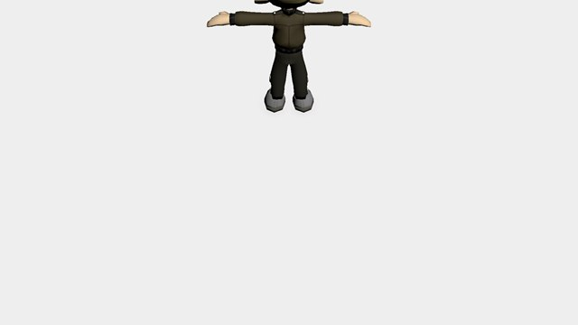</a></td><td><a href="docs/assets/challenge-scenes/0065-reference.jpg">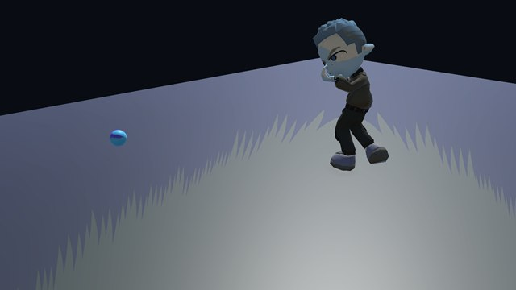</a></td></tr>
</table>

### 0051 — Animation Classification

**Hard · 20 milestone tests** · `0051-AnimationClassification`

Inspect each character's animation and group it under the matching animation-description node.

<table>
<tr><th width="50%">Initial Challenge Template</th><th width="50%">Completed Golden Reference</th></tr>
<tr><td></td><td></td></tr>
</table>

### 0079 — Synchronize Remote SCAR Weapon Presentation

**Hard · 18 milestone tests** · `0079-FPSRemoteWeaponAnimationSync`

Synchronize the remote third-person weapon, hands, poses, and recoil while preserving first-person behavior.

<table>
<tr><th width="50%">Initial Challenge Template</th><th width="50%">Completed Golden Reference</th></tr>
<tr><td></td><td><a href="docs/assets/challenge-scenes/0079-reference.jpg">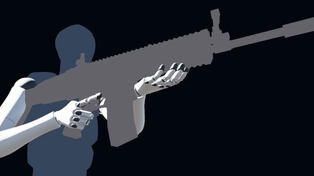</a></td></tr>
</table>

<strong>Editor Operations</strong> · 11 tasks · 142 milestone tests

### 0004 — Island Bench Road Group Cleanup

**Easy · 9 milestone tests** · `0004-IslandBenchRoadClassification`

Classify straight road segments into the existing named road groups while preserving their world transforms.

<table>
<tr><th width="50%">Initial Challenge Template</th><th width="50%">Completed Golden Reference</th></tr>
<tr><td></td><td><a href="docs/assets/challenge-scenes/0004-reference.jpg">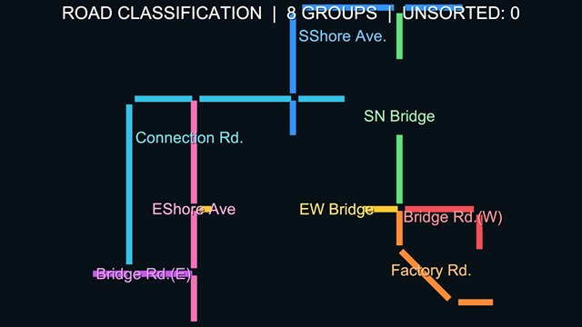</a></td></tr>
</table>

### 0013 — M249

**Easy · 15 milestone tests** · `0013-M249MachineGun`

Integrate the M249 with the existing item, player-carrying, and shooting systems.

<table>
<tr><th width="50%">Initial Challenge Template</th><th width="50%">Completed Golden Reference</th></tr>
<tr><td></td><td><a href="docs/assets/challenge-scenes/0013-reference.jpg">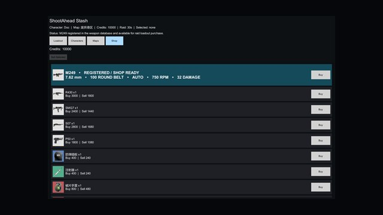</a></td></tr>
</table>

### 0014 — ShootAhead Asset Pruning

**Easy · 15 milestone tests** · `0014-ShootAheadAssetPruning`

Remove unused assets and demos while retaining everything required by the current build and runtime.

<table>
<tr><th width="50%">Initial Challenge Template</th><th width="50%">Completed Golden Reference</th></tr>
<tr><td></td><td></td></tr>
</table>

### 0027 — Automated Scene Grouping and Renaming Based on Spatial Bounding-Box Features

**Easy · 16 milestone tests** · `0027-VolumeBoundsOrganizer`

Automate scene-object grouping and renaming from spatial bounding-box features.

<table>
<tr><th width="50%">Initial Challenge Template</th><th width="50%">Completed Golden Reference</th></tr>
<tr><td><a href="docs/assets/challenge-scenes/0027-initial.jpg">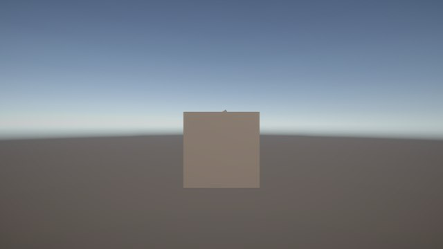</a></td><td><a href="docs/assets/challenge-scenes/0027-reference.jpg">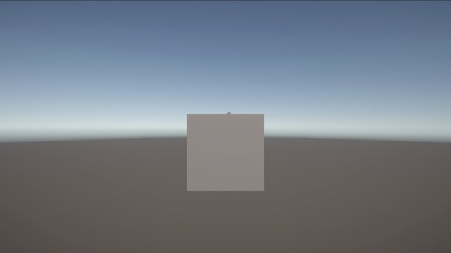</a></td></tr>
</table>

### 0028 — Import / Export Package Asset Organization

**Easy · 7 milestone tests** · `0028-ImportExportPackages`

Export the specified asset package and organize imported package assets in the existing project.

<table>
<tr><th width="50%">Initial Challenge Template</th><th width="50%">Completed Golden Reference</th></tr>
<tr><td></td><td></td></tr>
</table>

### 0042 — Prefab Asset Modification, Loose Object Replacement, and Variant Construction

**Easy · 16 milestone tests** · `0042-PrefabSharedMaterialIsolation`

Modify shared prefabs, replace loose objects, and create variants while preserving links and material isolation.

<table>
<tr><th width="50%">Initial Challenge Template</th><th width="50%">Completed Golden Reference</th></tr>
<tr><td><a href="docs/assets/challenge-scenes/0042-initial.jpg">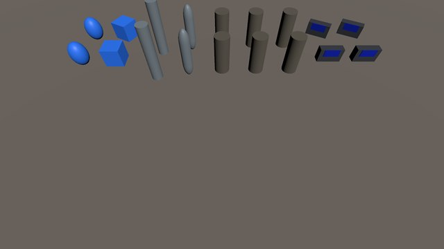</a></td><td><a href="docs/assets/challenge-scenes/0042-reference.jpg">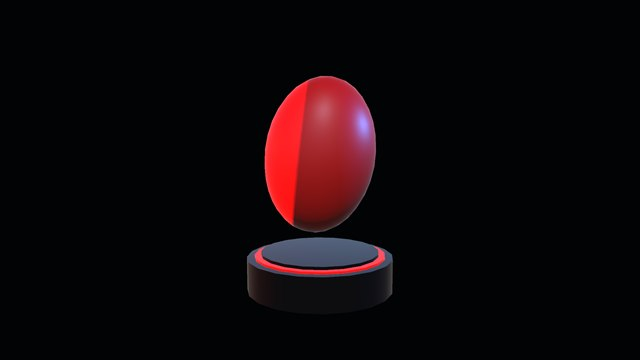</a></td></tr>
</table>

### 0052 — URP Pipeline Configuration

**Easy · 8 milestone tests** · `0052-URPPipelineConfiguration`

Configure the Universal Render Pipeline and convert the sample materials.

<table>
<tr><th width="50%">Initial Challenge Template</th><th width="50%">Completed Golden Reference</th></tr>
<tr><td></td><td><a href="docs/assets/challenge-scenes/0052-reference.jpg">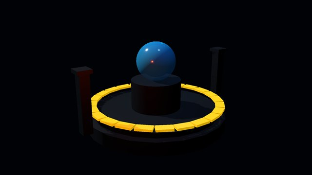</a></td></tr>
</table>

### 0016 — Automated Texture Import Pipeline Based on Semantic Routing and Low-Level Memory Defense

**Medium · 8 milestone tests** · `0016-TexturePipeline`

Implement a texture import pipeline that routes assets by naming semantics and configures import settings.

<table>
<tr><th width="50%">Initial Challenge Template</th><th width="50%">Completed Golden Reference</th></tr>
<tr><td></td><td></td></tr>
</table>

### 0018 — Find GameObjects in a Complex Scene

**Medium · 10 milestone tests** · `0018-FindGameObjectsInComplexScene`

Find GameObjects that satisfy the specified criteria and group them under the corresponding answer nodes.

<table>
<tr><th width="50%">Initial Challenge Template</th><th width="50%">Completed Golden Reference</th></tr>
<tr><td></td><td><a href="docs/assets/challenge-scenes/0018-reference.jpg">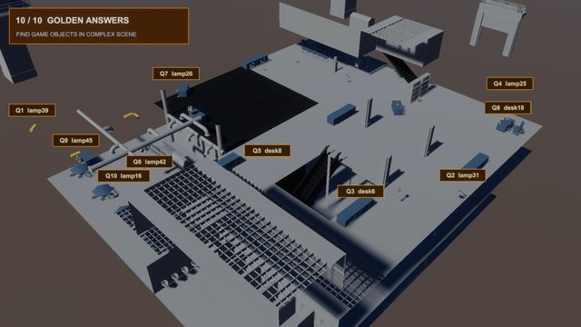</a></td></tr>
</table>

### 0060 — Build a Production Gunshot Audio System

**Hard · 29 milestone tests** · `0060-GunShotSound`

Build a data-driven, pooled gunshot audio system with weapon profiles, distance layers, and environmental effects.

<table>
<tr><th width="50%">Initial Challenge Template</th><th width="50%">Completed Golden Reference</th></tr>
<tr><td></td><td><a href="docs/assets/challenge-scenes/0060-reference.jpg">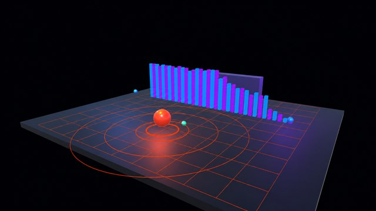</a></td></tr>
</table>

### 0072 — Classify Castle Structures into Hierarchy Groups

**Hard · 9 milestone tests** · `0072-CastleDestruction`

Group the specified castle structures while preserving world transforms and leaving continuous walls unsorted.

<table>
<tr><th width="50%">Initial Challenge Template</th><th width="50%">Completed Golden Reference</th></tr>
<tr><td><a href="docs/assets/challenge-scenes/0072-initial.jpg">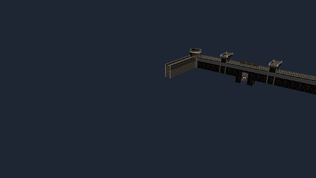</a></td><td><a href="docs/assets/challenge-scenes/0072-reference.jpg">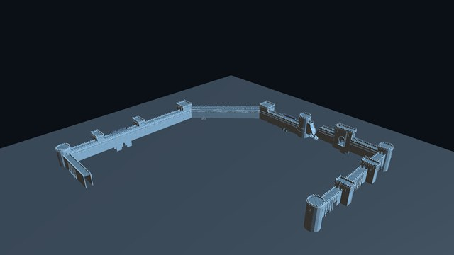</a></td></tr>
</table>

<strong>Scene &amp; Level Construction</strong> · 19 tasks · 365 milestone tests

### 0001 — Object Identification and Categorization

**Easy · 33 milestone tests** · `0001-ObjectIdentificationPrefabSorting`

Identify and categorize thirty prefab objects under their matching answer groups.

<table>
<tr><th width="50%">Initial Challenge Template</th><th width="50%">Completed Golden Reference</th></tr>
<tr><td></td><td><a href="docs/assets/challenge-scenes/0001-reference.jpg">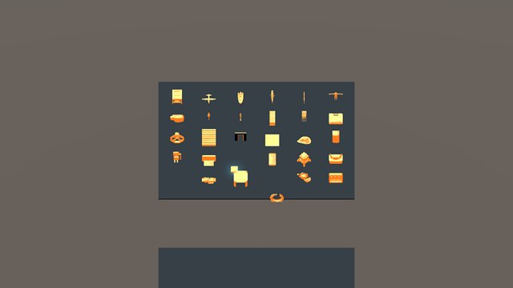</a></td></tr>
</table>

### 0021 — Street Intersection Assembly

**Easy · 10 milestone tests** · `0021-ShootAheadStreetLayout`

Assemble a street intersection from the supplied road, tree, and building prefabs.

<table>
<tr><th width="50%">Initial Challenge Template</th><th width="50%">Completed Golden Reference</th></tr>
<tr><td></td><td><a href="docs/assets/challenge-scenes/0021-reference.jpg">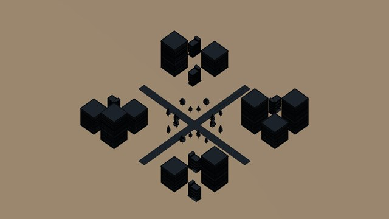</a></td></tr>
</table>

### 0040 — Object Identification and Categorization

**Easy · 33 milestone tests** · `0040-ObjectIdentificationPrefabSorting`

Identify and categorize thirty prefab objects in a separate object-classification scene.

<table>
<tr><th width="50%">Initial Challenge Template</th><th width="50%">Completed Golden Reference</th></tr>
<tr><td></td><td><a href="docs/assets/challenge-scenes/0040-reference.jpg">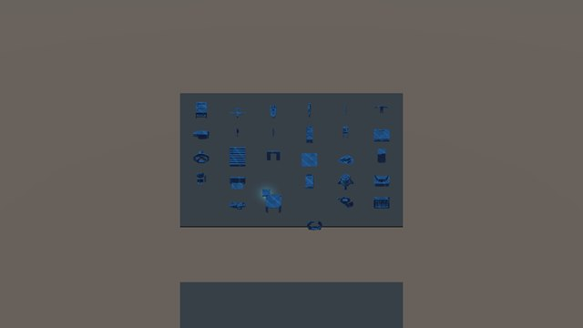</a></td></tr>
</table>

### 0005 — Paper-Thin Multistory House and Floor Reachability

**Medium · 4 milestone tests** · `0005-BuildHouseReachability`

Build a multistory house from Plane objects with navigable rooms and stairs connecting its floors.

<table>
<tr><th width="50%">Initial Challenge Template</th><th width="50%">Completed Golden Reference</th></tr>
<tr><td></td><td><a href="docs/assets/challenge-scenes/0005-reference.jpg">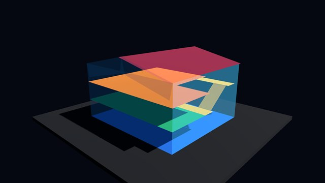</a></td></tr>
</table>

### 0020 — Interior Furniture Placement

**Medium · 39 milestone tests** · `0020-InteriorFurniturePlacement`

Furnish the supplied unfinished house according to the required room layouts and spatial relationships.

<table>
<tr><th width="50%">Initial Challenge Template</th><th width="50%">Completed Golden Reference</th></tr>
<tr><td><a href="docs/assets/challenge-scenes/0020-initial.jpg">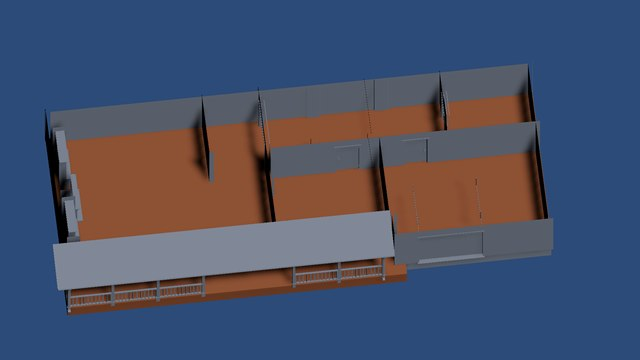</a></td><td><a href="docs/assets/challenge-scenes/0020-reference.jpg">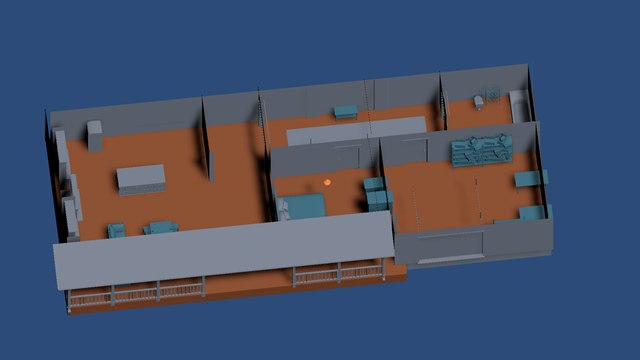</a></td></tr>
</table>

### 0022 — Reference Image Street Recreation

**Medium · 6 milestone tests** · `0022-ShootAheadReferenceStreet`

Recreate the reference street layout using the supplied ground, road, building, and tree assets.

<table>
<tr><th width="50%">Initial Challenge Template</th><th width="50%">Completed Golden Reference</th></tr>
<tr><td><a href="docs/assets/challenge-scenes/0022-initial.jpg">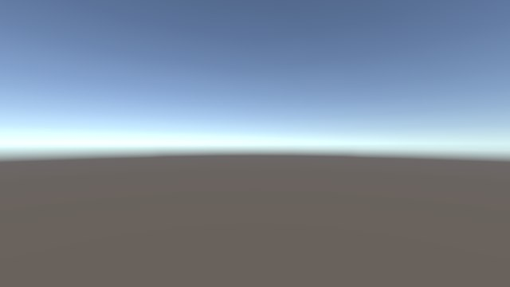</a></td><td></td></tr>
</table>

### 0034 — Sci-Fi Room Size Variants

**Medium · 6 milestone tests** · `0034-SciFiRoomVariants`

Assemble three separate sci-fi rooms with the required sizes using the supplied modular prefabs.

<table>
<tr><th width="50%">Initial Challenge Template</th><th width="50%">Completed Golden Reference</th></tr>
<tr><td></td><td><a href="docs/assets/challenge-scenes/0034-reference.jpg">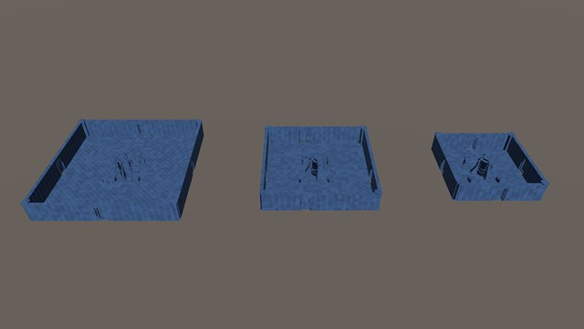</a></td></tr>
</table>

### 0036 — NavMeshAgent OffMeshLink Multi-Room Navigation

**Medium · 10 milestone tests** · `0036-NavMeshAgentOffMeshLink`

Configure multi-room NavMesh navigation and OffMeshLink connections while preserving validation markers.

<table>
<tr><th width="50%">Initial Challenge Template</th><th width="50%">Completed Golden Reference</th></tr>
<tr><td></td><td><a href="docs/assets/challenge-scenes/0036-reference.jpg">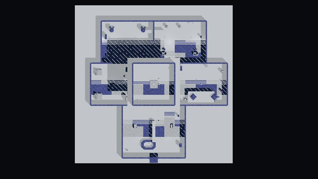</a></td></tr>
</table>

### 0043 — 11x11 Unique-Path Maze Construction

**Medium · 10 milestone tests** · `0043-MazeObstacleParenting`

Construct unique-path 11-by-11 mazes in ten scenes while preserving their required hierarchies.

<table>
<tr><th width="50%">Initial Challenge Template</th><th width="50%">Completed Golden Reference</th></tr>
<tr><td><a href="docs/assets/challenge-scenes/0043-initial.jpg">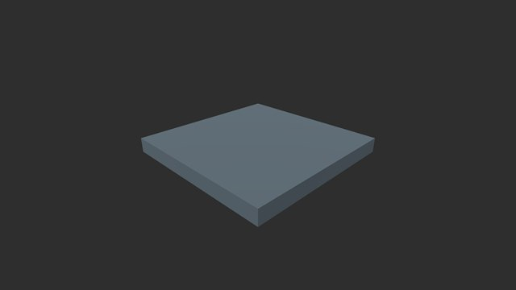</a></td><td><a href="docs/assets/challenge-scenes/0043-reference.jpg">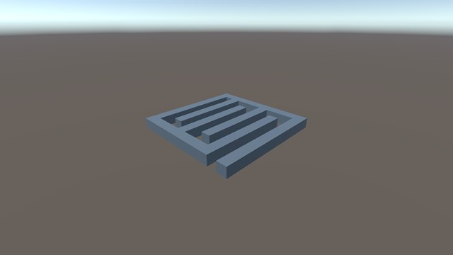</a></td></tr>
</table>

### 0069 — Trench Asset Assembly

**Medium · 16 milestone tests** · `0069-TrenchAssembly`

Assemble the supplied trench segments to satisfy the required layout and navigation constraints.

<table>
<tr><th width="50%">Initial Challenge Template</th><th width="50%">Completed Golden Reference</th></tr>
<tr><td></td><td><a href="docs/assets/challenge-scenes/0069-reference.jpg">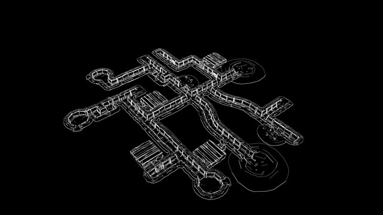</a></td></tr>
</table>

### 0066 — Shop 3D Letter Signs

**Hard · 44 milestone tests** · `0066-Shop3DLetters`

Assemble readable PIZZA PLACE and BOOK STORE signs from the supplied uppercase letter prefabs.

<table>
<tr><th width="50%">Initial Challenge Template</th><th width="50%">Completed Golden Reference</th></tr>
<tr><td></td><td></td></tr>
</table>

### 0067 — Terrain River and Lake Water Surface Assembly

**Hard · 14 milestone tests** · `0067-TerrainRiverWaterAssembly`

Connect the higher and lower lakes with a continuous water surface along the existing terrain riverbed.

<table>
<tr><th width="50%">Initial Challenge Template</th><th width="50%">Completed Golden Reference</th></tr>
<tr><td></td><td></td></tr>
</table>

### 0068 — Shanghai Circuit Terrain Painting, White Lines, and Turn Props

**Hard · 28 milestone tests** · `0068-ShanghaiCircuitTerrainPaint`

Recreate the Shanghai Circuit on Terrain, including white track lines and turn props.

<table>
<tr><th width="50%">Initial Challenge Template</th><th width="50%">Completed Golden Reference</th></tr>
<tr><td></td><td></td></tr>
</table>

### 0070 — Place Indoor and Outdoor Observation Cameras

**Hard · 11 milestone tests** · `0070-CameraPlacement`

Place and orient nine cameras so they clearly observe their assigned indoor and outdoor props.

<table>
<tr><th width="50%">Initial Challenge Template</th><th width="50%">Completed Golden Reference</th></tr>
<tr><td></td><td></td></tr>
</table>

### 0071 — Decorate Terrain with Natural Trees and Riverside Rocks

**Hard · 24 milestone tests** · `0071-PlantsDecoration`

Plant the required terrain trees and arrange fifty grounded riverside rocks with natural variation.

<table>
<tr><th width="50%">Initial Challenge Template</th><th width="50%">Completed Golden Reference</th></tr>
<tr><td></td><td></td></tr>
</table>

### 0073 — Connect Castle Circulation with Supplied Stair Prefabs

**Hard · 9 milestone tests** · `0073-CastleConstruction`

Connect the castle interior, wall walks, gate, and bastions using only the approved stair prefabs.

<table>
<tr><th width="50%">Initial Challenge Template</th><th width="50%">Completed Golden Reference</th></tr>
<tr><td></td><td></td></tr>
</table>

### 0075 — Restore the Crystal Fragment Assembly

**Hard · 14 milestone tests** · `0075-CrystalFragment`

Restore fourteen scattered crystal fragments around two fixed anchors using only translation and rotation.

<table>
<tr><th width="50%">Initial Challenge Template</th><th width="50%">Completed Golden Reference</th></tr>
<tr><td></td><td></td></tr>
</table>

### 0076 — Build a White-Box House from a Floor Plan

**Hard · 23 milestone tests** · `0076-BuildHouseFromDesign`

Reconstruct the supplied floor plan as a dimensioned white-box house with correctly grouped architectural elements.

<table>
<tr><th width="50%">Initial Challenge Template</th><th width="50%">Completed Golden Reference</th></tr>
<tr><td></td><td></td></tr>
</table>

### 0080 — Add Correct Lane-Direction Arrows to Urban Intersections

**Hard · 31 milestone tests** · `0080-UrbanRoads`

Place correctly oriented lane-direction arrows on the specified urban intersection approaches.

<table>
<tr><th width="50%">Initial Challenge Template</th><th width="50%">Completed Golden Reference</th></tr>
<tr><td></td><td></td></tr>
</table>

<strong>Particles &amp; Shaders</strong> · 12 tasks · 155 milestone tests

### 0007 — Shadertoy Black Hole Skybox

**Easy · 26 milestone tests** · `0007-SkyboxBlackHole`

Convert the supplied Shadertoy black-hole fragment shader into a Unity skybox shader.

<table>
<tr><th width="50%">Initial Challenge Template</th><th width="50%">Completed Golden Reference</th></tr>
<tr><td></td><td></td></tr>
</table>

### 0030 — Firework Trailing Smoke

**Easy · 13 milestone tests** · `0030-Fireworks-TrailingSmoke`

Create a dense, dissipating firework smoke trail with turbulence and emission opposite the rocket's travel.

<table>
<tr><th width="50%">Initial Challenge Template</th><th width="50%">Completed Golden Reference</th></tr>
<tr><td></td><td></td></tr>
</table>

### 0031 — Firework Trailing Sparks

**Easy · 15 milestone tests** · `0031-Fireworks-TrailingSparks`

Create bright trailing firework sparks with streaks, backward initial velocity, and gravity-driven fall.

<table>
<tr><th width="50%">Initial Challenge Template</th><th width="50%">Completed Golden Reference</th></tr>
<tr><td></td><td></td></tr>
</table>

### 0032 — Firework Head Halo

**Easy · 13 milestone tests** · `0032-Fireworks-HeadHalo`

Create a bright, flickering particle halo attached to the ascending firework's head.

<table>
<tr><th width="50%">Initial Challenge Template</th><th width="50%">Completed Golden Reference</th></tr>
<tr><td></td><td></td></tr>
</table>

### 0033 — Firework Explosion Effect

**Easy · 19 milestone tests** · `0033-Fireworks-ExplosionEffect`

Create a firework burst with rapid expansion, deceleration, color transitions, and falling residual sparks.

<table>
<tr><th width="50%">Initial Challenge Template</th><th width="50%">Completed Golden Reference</th></tr>
<tr><td></td><td></td></tr>
</table>

### 0024 — Pine Material URP Conversion

**Medium · 5 milestone tests** · `0024-CoastDunesPineUrpMaterials`

Convert the specified pine materials to URP while preserving their textures, colors, and transparency.

<table>
<tr><th width="50%">Initial Challenge Template</th><th width="50%">Completed Golden Reference</th></tr>
<tr><td></td><td></td></tr>
</table>

### 0037 — Particle Effect Classification

**Medium · 10 milestone tests** · `0037-ClassificationOfParticleSystem`

Inspect the supplied particle effects and group them under their matching effect categories.

<table>
<tr><th width="50%">Initial Challenge Template</th><th width="50%">Completed Golden Reference</th></tr>
<tr><td></td><td></td></tr>
</table>

### 0047 — Dynamic Dissolve

**Medium · 10 milestone tests** · `0047-DynamicDissolve`

Build a URP dissolve Shader Graph with edge emission, animated noise, and subtle vertex deformation.

<table>
<tr><th width="50%">Initial Challenge Template</th><th width="50%">Completed Golden Reference</th></tr>
<tr><td></td><td></td></tr>
</table>

### 0059 — Particle Collision Splash Task

**Medium · 10 milestone tests** · `0059-RainEmitter`

Complete the rain particle effect so raindrops create splashes when they collide with the water surface.

<table>
<tr><th width="50%">Initial Challenge Template</th><th width="50%">Completed Golden Reference</th></tr>
<tr><td></td><td></td></tr>
</table>

### 0012 — Restore Skinned-Mesh VFX Graph Particles and Trails

**Hard · 13 milestone tests** · `0012-Smrvfx`

Restore three VFX Graph assets whose particles and trails follow an animated skinned character under Timeline control.

<table>
<tr><th width="50%">Initial Challenge Template</th><th width="50%">Completed Golden Reference</th></tr>
<tr><td></td><td></td></tr>
</table>

### 0038 — Create a Dynamic Rain Effect

**Hard · 8 milestone tests** · `0038-DynamicRainEffect`

Create world-space rain that follows the player and responds naturally to horizontal movement.

<table>
<tr><th width="50%">Initial Challenge Template</th><th width="50%">Completed Golden Reference</th></tr>
<tr><td></td><td></td></tr>
</table>

### 0045 — Create an Interactable Falling Leaves Effect

**Hard · 13 milestone tests** · `0045-InteractableLeaves`

Create falling leaves that settle on the ground and react to the wind field around the player.

<table>
<tr><th width="50%">Initial Challenge Template</th><th width="50%">Completed Golden Reference</th></tr>
<tr><td></td><td></td></tr>
</table>

<strong>Physics &amp; Collision</strong> · 11 tasks · 168 milestone tests

### 0002 — Build a Rigidbody-Driven Cube Movement Scene

**Easy · 20 milestone tests** · `0002-CubeMove`

Implement a visible cube player with testable Rigidbody-driven movement and jumping.

<table>
<tr><th width="50%">Initial Challenge Template</th><th width="50%">Completed Golden Reference</th></tr>
<tr><td></td><td></td></tr>
</table>

### 0054 — Procedural Skinned Cloth

**Easy · 10 milestone tests** · `0054-ProceduralSkinnedCloth`

Build a procedural skinned-cloth setup with stable simulation and the required collision behavior.

<table>
<tr><th width="50%">Initial Challenge Template</th><th width="50%">Completed Golden Reference</th></tr>
<tr><td></td><td></td></tr>
</table>

### 0057 — Voxel Worms Terrain

**Easy · 12 milestone tests** · `0057-VoxelWormsTerrain`

Implement destructible voxel island terrain with synchronized procedural meshes and runtime collision updates.

<table>
<tr><th width="50%">Initial Challenge Template</th><th width="50%">Completed Golden Reference</th></tr>
<tr><td></td><td></td></tr>
</table>

### 0003 — Catapult Explosion

**Medium · 11 milestone tests** · `0003-CatapultExplosion`

Complete the catapult's animation-timed projectile launch and physics-driven explosion effects.

<table>
<tr><th width="50%">Initial Challenge Template</th><th width="50%">Completed Golden Reference</th></tr>
<tr><td></td><td></td></tr>
</table>

### 0026 — Vehicle Control with WheelColliders

**Medium · 8 milestone tests** · `0026-ShootAheadVehicleWheelPhysics`

Implement runnable vehicle physics with WheelColliders using the existing car model and test track.

<table>
<tr><th width="50%">Initial Challenge Template</th><th width="50%">Completed Golden Reference</th></tr>
<tr><td></td><td></td></tr>
</table>

### 0039 — Inclined Rolling Ball Checkpoint Guidance

**Medium · 15 milestone tests** · `0039-RollingBallCheckpointCourse`

Guide a rolling ball through all required checkpoints in three distinct obstacle-course scenes.

<table>
<tr><th width="50%">Initial Challenge Template</th><th width="50%">Completed Golden Reference</th></tr>
<tr><td></td><td></td></tr>
</table>

### 0048 — Roadside Joint Physics

**Medium · 12 milestone tests** · `0048-RoadsideJointPhysics`

Configure four roadside physics scenes using the specified Unity Joint components.

<table>
<tr><th width="50%">Initial Challenge Template</th><th width="50%">Completed Golden Reference</th></tr>
<tr><td></td><td></td></tr>
</table>

### 0056 — Rigidbody Character Controller Parity

**Medium · 15 milestone tests** · `0056-RigidbodyCharacterControllerParity`

Implement a Rigidbody character controller that matches the supplied movement, jumping, slope, and collision reference.

<table>
<tr><th width="50%">Initial Challenge Template</th><th width="50%">Completed Golden Reference</th></tr>
<tr><td></td><td></td></tr>
</table>

### 0044 — Collider Wrapping Challenge

**Hard · 26 milestone tests** · `0044-ColliderWrappingChallenge`

Complete the collider rigs around the supplied objects to satisfy the required geometric and collision constraints.

<table>
<tr><th width="50%">Initial Challenge Template</th><th width="50%">Completed Golden Reference</th></tr>
<tr><td></td><td></td></tr>
</table>

### 0053 — PhysicMaterial Tuning

**Hard · 8 milestone tests** · `0053-PhysicsMaterial`

Tune four physics materials for checkpoint traversal and the curling scene's scoring objective.

<table>
<tr><th width="50%">Initial Challenge Template</th><th width="50%">Completed Golden Reference</th></tr>
<tr><td></td><td></td></tr>
</table>

### 0077 — Implement Physical Fixed-Wing Takeoff and Landing

**Hard · 31 milestone tests** · `0077-TakeOffAndLanding`

Implement an autonomous Rigidbody aircraft controller that takes off, flies a return circuit, lands, and brakes to a stop.

<table>
<tr><th width="50%">Initial Challenge Template</th><th width="50%">Completed Golden Reference</th></tr>
<tr><td></td><td></td></tr>
</table>

<strong>Miscellaneous</strong> · 3 tasks · 58 milestone tests

### 0011 — Light Cookie Application

**Easy · 9 milestone tests** · `0011-CookiesApply`

Configure Directional Light and Point Light cookies to produce the required lighting projections.

<table>
<tr><th width="50%">Initial Challenge Template</th><th width="50%">Completed Golden Reference</th></tr>
<tr><td></td><td></td></tr>
</table>

### 0017 — LOD Asset Creation

**Medium · 39 milestone tests** · `0017-CreateLOD`

Create, merge, and split model LOD assets with the required LODGroup configuration.

<table>
<tr><th width="50%">Initial Challenge Template</th><th width="50%">Completed Golden Reference</th></tr>
<tr><td></td><td></td></tr>
</table>

### 0019 — Timeline Cinematic Auto-Generation

**Hard · 10 milestone tests** · `0019-AutoTimelineGenerator`

Write an editor script that assembles the supplied animation, VFX, and audio into a Timeline cinematic.

<table>
<tr><th width="50%">Initial Challenge Template</th><th width="50%">Completed Golden Reference</th></tr>
<tr><td></td><td></td></tr>
</table>

## Task Structure

Each task pairs an existing Unity project with a natural-language specification organized into **Goal**, **Context**, **Constraints**, and **Resources**. Agents modify the project to satisfy the requirements while preserving the functionality specified by the task.

## Evaluation Overview

After agent execution, held-out **EditMode** and **PlayMode** tests check the final project's structure, configuration, and runtime behavior. Each task receives partial credit based on its proportion of passing milestones; the benchmark score is the equally weighted mean of task scores.

## Release Roadmap

- [ ] Unity task projects
- [ ] Evaluation framework
- [ ] Setup and evaluation instructions
